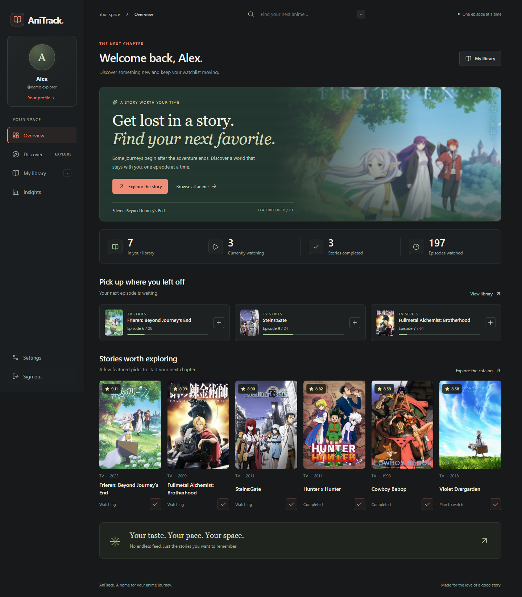

# AniTrack

A full-stack anime discovery and watchlist application built with **React + TypeScript** and **ASP.NET Core 10**. Explore **28,302 titles**, keep your progress, rate what you watch, and understand your viewing habits.

[](https://github.com/Fegi176/AniTrack/actions/workflows/ci.yml)



Additional previews: [Discovery](docs/screenshots/discover.png), [watchlist](docs/screenshots/library.png), [insights](docs/screenshots/insights.png), and [phone layout](docs/screenshots/mobile.png).

## Features

- Public catalog with Unicode-aware alternate-title search, genre/year/format filters, editorial and rating sorts, numbered pagination, adjustable page sizes, and source links.
- Accounts with ASP.NET Core Identity, password hashing, login lockout, HTTP-only cookie sessions, and CSRF protection. Credentials are never stored in browser local storage.
- Private watchlists with five statuses, episode progress, optional 1–10 ratings, and private notes.
- One-click episode updates; the last episode completes a title automatically.
- Optimistic concurrency checks prevent a stale browser tab from overwriting newer progress. Conflicts offer a reload action so the user can review the latest version before retrying.
- Session changes are synchronized across tabs, clearing private views when another tab signs out. Requests have a timeout and expired CSRF tokens are refreshed safely.
- Insights calculated from saved data: episode totals, estimated watch time, average rating, status breakdown, genres, and rating distribution.
- Editable display name and bio.
- Upload, replace, and remove a profile picture from Settings. JPG, PNG, and WebP uploads up to 2 MB are checked and cropped to a 256 px square on the server. Pictures persist with the account and appear in the left sidebar.
- A dedicated login page is the entry screen for signed-out visitors. Existing sessions open the overview; public catalog browsing remains available.
- MyAnimeList XML import/export, including progress, ratings, and notes. Imports validate before saving; unsupported titles are counted as skipped. Duplicate IDs are skipped.
- Separate demo accounts for each visitor, enabled only in local Development by default.
- Responsive layout, readable contrast, trapped keyboard focus in mobile navigation and dialogs, restored focus after closing dialogs, reduced-motion support, image fallbacks, and loading/error/empty states.

## Stack and layout

| Layer | Tools |
| --- | --- |
| Client | React 19, TypeScript, Vite, React Router, TanStack Query, Lucide |
| API | ASP.NET Core 10 minimal APIs, Identity, OpenAPI, rate limiting |
| Persistence | EF Core 10, SQLite, versioned migrations |
| Verification | xUnit API integration tests, Playwright browser tests, TypeScript, Oxlint |
| Delivery | Docker image, Compose persistence, GitHub Actions CI |

```text
backend/AnimeTracker.Api/
  Domain/             User, anime, and library entities
  Data/               EF context and seed catalog
  Features/           Account, catalog, library, and import/export endpoints
  Migrations/         Initial database schema
frontend/
  src/components/     Shared UI and dialogs
  src/pages/          Overview, discovery, library, insights, settings
  src/api.ts          HTTP client and CSRF handling
  e2e/                Browser journeys
tests/AnimeTracker.Tests/   API integration tests with isolated SQLite databases
scripts/dev.ps1       Windows development launcher
docs/                 Architecture, rebuild notes, sample XML, screenshots
```

## Run on Windows

Prerequisites: Node.js 24 LTS and the [.NET 10 SDK](https://dotnet.microsoft.com/download/dotnet/10.0). This local workspace also has an ignored SDK under `.tools/dotnet`; the launcher uses it when `dotnet` is not on PATH.

From the project root:

```powershell
.\scripts\dev.ps1
```

Open **http://127.0.0.1:5173**. The login page appears when signed out. Click **Try the demo**, or create an account with a username and a password of at least eight characters, including a lowercase letter and a number. The launcher installs missing frontend dependencies, builds the API, waits for it to start, and shuts it down when the frontend exits. Logs are in `.tools/api.log` and `.tools/api-error.log`.

Alternatively, use two terminals on Windows, macOS, or Linux:

```sh
# Terminal 1, repository root. The http launch profile enables Development.
dotnet run --project backend/AnimeTracker.Api --launch-profile http

# Terminal 2
cd frontend
npm ci
npm run dev
```

The API runs at `http://localhost:5000`. Vite forwards `/api` requests to it, keeping cookies and CSRF handling on one browser origin. The first API launch applies migrations and imports the catalog snapshot. A changed catalog version updates existing titles without deleting accounts or watchlists. Subsequent starts skip the import when the version is unchanged. No database service or API key is needed.

Development API schema: http://localhost:5000/openapi/v1.json. Health check: http://localhost:5000/api/health.

## Verify

```sh
# Repository root
dotnet test AnimeTracker.slnx

cd frontend
npm ci
npm run lint
npm run format:check
npm run build
npx playwright install chromium
# Start the Development API in another terminal before running browser tests.
npm run test:e2e
```

API tests cover catalog size and attribution, Unicode aliases, page boundaries, session and CSRF requirements, login/logout, user isolation, invalid progress and ratings, automatic completion, stale updates, deletion, XML round trips, atomic import validation, DTD rejection, and catalog refreshes that preserve user data.

Browser tests cover discovery, account creation, persistence across reloads, progress, insights, profile updates, XML download/upload, demo access, multi-tab conflicts, cross-tab logout, unavailable servers, stalled requests, missing images and metadata, and keyboard focus. Automated WCAG AA checks run on all five main pages at **1440, 768, 390, and 320 pixels**, plus the sign-in, registration, and detail dialogs. See [review notes](docs/portfolio-review.md) for the scope and remaining limitations.

To regenerate screenshots with both development servers running:

```sh
cd frontend
node scripts/preview.mjs
```

## Docker

```sh
docker compose up --build
```

Open http://localhost:8080. This builds the React app and serves it from ASP.NET Core as one application. The SQLite database and session encryption keys persist in the `anime-data` volume. Demo access is disabled in this configuration. The port is bound to localhost. Docker packaging is included; the container build has not been executed in this workspace.

For a hosted deployment, terminate HTTPS at a reverse proxy, configure trusted forwarded headers and secure cookies for that environment, persist and protect `App_Data`, and run migrations as a deployment step when scaling beyond one instance. This starter applies migrations at startup for the single-instance setup.

The GitHub repository publishes the source and automated checks. [GitHub Pages](https://docs.github.com/en/pages/getting-started-with-github-pages/what-is-github-pages) serves static files and cannot run the ASP.NET Core API or SQLite database. A working public application needs a .NET 10 or Docker host with persistent storage for `App_Data`.

## Data and scope

The application ships a **28,302-title catalog** derived from [anime-offline-database, release 2026-27](https://github.com/manami-project/anime-offline-database/releases/tag/2026-27), dated **July 4, 2026**. It is a snapshot, not a live feed. Scores are upstream aggregate ratings; upcoming titles without released ratings appear unrated. Editor's picks prioritize a short, explicitly curated set before the remaining catalog. Poster URLs reference external providers; no poster files are bundled.

The dataset uses the **Open Data Commons ODbL 1.0 + DbCL 1.0** licenses. The derived database, upstream license, provenance, and transformation notes are in [Data/NOTICE.md](backend/AnimeTracker.Api/Data/NOTICE.md). Missing synopses, runtimes, studios, and dates are shown as unavailable. Short original summaries are supplied for the featured editorial set. Unknown runtimes are excluded from the watch-time estimate.

Rebuild the same catalog from the pinned upstream release with:

```sh
node scripts/build-catalog.mjs --download
```

The raw source download stays in ignored `.tools/`. The script records source and output hashes in `catalog-info.json`; restart the API to apply a changed version. The source repository is archived, so this command reproduces the pinned snapshot rather than promising future updates.

XML imports match MyAnimeList IDs against this catalog; they do not create or fetch unknown titles. Try `docs/sample-list.xml`. Export preserves the supported fields rather than every field in a full MyAnimeList export. Existing MusicQuiz databases and account password hashes are not automatically migrated.

The delivered scope is a working local portfolio application. Live catalog ingestion, account recovery/email verification, public social profiles, and catalog administration remain possible extensions. No real payment or streaming functionality is included.

See [architecture](docs/architecture.md) and [rebuild decisions](docs/rebuild.md) for the design and migration rationale.
