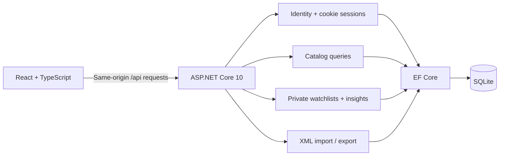

# Architecture

AniTrack uses one React client and one ASP.NET Core application, with feature folders inside the API. Keeping one backend makes local setup, transactions, debugging, and deployment straightforward for this project's size.

During development, Vite proxies API requests. In the Docker build, ASP.NET Core serves the compiled frontend and API under one origin. No CORS configuration or browser-held bearer token is necessary.

## Domain and invariants

- `AppUser` extends Identity with a display name, bio, creation timestamp, and optional profile thumbnail. Password hashing and lockout belong to Identity.
- `Anime` has a stable MyAnimeList ID. A versioned 28,302-title snapshot supplies metadata and normalized alternate titles. Source and license information are persisted alongside the catalog. Startup upserts changed snapshots while preserving accounts and library rows.
- `LibraryEntry` is unique per `(UserId, AnimeId)`. Every endpoint derives the user ID from the authenticated session rather than trusting a user ID in a request.
- Progress cannot be negative or exceed a known episode count. Scores are optional; when supplied they must be 1–10. Notes have a 2,000-character limit.
- `PlanToWatch` means zero episodes. `Completed` marks all known episodes watched. Reaching the episode count automatically sets `Completed`.
- Each save replaces a GUID revision. Clients send the revision they read; stale updates and deletes return HTTP 409. The EF concurrency token and unique index also protect simultaneous writes.
- A title without a known episode count cannot be automatically completed from progress alone.
- `LibraryActivity` stores before/after progress, status, and rating snapshots, plus a title snapshot that survives removal. It records that notes changed without copying their private text.
- `UserAchievement` has a unique `(UserId, Code)` key and a permanent unlock timestamp. Nine server-defined milestones use saved library totals, completions, episodes, ratings, completed-title genres, and completed movies.

## Requests and state

TanStack Query owns server state and invalidates library and insight queries after mutations. Browser history owns catalog filter state. Draft forms stay local to their dialogs. Changing accounts clears private cached data.

Cross-tab session changes use `BroadcastChannel`. Other tabs clear private library, insight, history, and achievement queries and open editors before refreshing the current session. Anonymous session discovery returns explicit JSON `null`. The HTTP client serializes concurrent CSRF initialization, retries only a request rejected for a stale CSRF token, and times out stalled network requests after 15 seconds. Validation and ordinary server errors are not retried as writes.

Catalog pages are bounded by the actual result count, including for outdated links to large page numbers. Search aliases are normalized with Unicode compatibility normalization and invariant casing. Filter metadata is projected and cached rather than loading full title objects for each filter request.

The HTTP client requests an antiforgery token and includes it on all state-changing requests. It resets the token after authentication changes because tokens are tied to the current identity. Session cookies are HTTP-only and use SameSite=Lax. Login attempts are rate limited by IP and password failures can lock an account temporarily.

Errors use Problem Details. The UI renders actionable errors and does not substitute fabricated data when an API request fails.

Opening `/` without a session redirects to `/login`. A valid session redirects away from `/login` to the overview. The standalone login page reuses the sign-in and registration form from catalog dialogs. The catalog can still be browsed publicly.

## Profile pictures

Authenticated, CSRF-protected picture uploads accept up to 2 MB of JPG, PNG, or WebP. The server checks the decoded format, bounds dimensions to 8,192 px and 16 million pixels, and rejects unreadable or truncated files. [SkiaSharp](https://github.com/mono/SkiaSharp) applies camera orientation, crops the center square, and re-encodes a fresh 256 × 256 PNG without source metadata. Windows/macOS native assets and the Linux NoDependencies assets are included in the API package.

Only the thumbnail and a version identifier are stored in SQLite; original uploads and filenames are discarded. Pictures are served through an owner-only endpoint with `private, no-store` caching. Replacing/removing a picture invalidates its previous URL. The client shows the user's initial when no picture is set or an image fails to load.

## History and achievements

Library writes commit progress, history, and newly earned achievements in one database transaction. Rejected edits and invalid imports create no events or awards. Saving identical values creates no activity. Removing a title leaves its activity and earned milestones intact. Both read endpoints scope queries to the signed-in user; history is ordered by UTC timestamp and ID and paged at 20 items.

XML imports create one batch event with added/updated/skipped counts. They qualify for milestones but never create fake viewing dates. On startup, existing library progress is recognized idempotently for achievements, without reconstructing past activity. Unlock dates represent recognition time. There is no client endpoint that grants badges.

## Import and export

The importer accepts up to 2 MB of XML. It disables DTDs and external entity resolution. It validates matching rows before calling `SaveChangesAsync`, so an invalid matching row does not leave a partially imported list. Existing notes are retained when no comment element is present. Duplicate or unknown IDs are counted as skipped. Concurrency/database conflicts reject the save.

The exporter uses `XDocument` for XML escaping and returns a downloadable document containing the supported watchlist fields.

## Persistence and operations

Versioned EF migrations create the database schema. SQLite is appropriate for a simple single-instance demo and avoids requiring a database server to review the project. SQLite data, WAL files, and Data Protection keys live in `App_Data`, which is excluded from Git. The container mounts that directory as a persistent volume.

The catalog transformation is reproducible from a pinned upstream release. `catalog-info.json` records source and output hashes; `LICENSE.catalog.txt` and `NOTICE.md` describe the database's ODbL/DbCL terms. Missing metadata remains unknown. The original summaries are separate editorial content rather than generated replacements for missing descriptions.

For multiple API instances, move to a server database, coordinate schema migrations, and share protected Data Protection keys. Demo users currently persist until removed from the database; the endpoint is disabled in production by default. Password reset and email verification are outside the current local portfolio scope.
